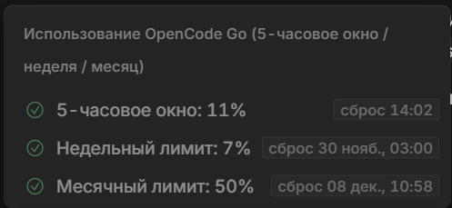

# opencode-go-usage

OpenCode Go usage limits as a pill in OpenCode Desktop — no need to open the console.



The pill above your composer shows the three Go allowances: the 5-hour window, the weekly limit and the monthly one, refreshed every minute. Green by default, yellow above 65%, red above 85%; click it for each limit's reset time. The plugin reads your saved OpenCode Go key through the running OpenCode server's API and polls `https://opencode.ai/inference/go/v1/usage` — the key is never written to a config file.

### Install

Requires OpenCode Desktop and a saved OpenCode Go key (`/connect` → OpenCode Go).

```sh
opencode plugin add @nightdread/opencode-go-usage
```

or from this repository:

```sh
opencode plugin add github:nightdread/opencode-go-usage
```

or manually: copy the folder with `gui-experimental.cjs` at its root, e.g. `~/.config/opencode/plugins/go-usage`, and add the path to `plugins` in `opencode.json`.

### Build from source

```sh
npm install
npm run bundle
```

MIT licensed. Русская версия README — ниже.

---

# opencode-go-usage · Русский

GUI-плагин OpenCode Desktop: показывает остаток лимитов OpenCode Go прямо в приложении — пилюлей над строкой ввода, чтобы не открывать консоль.


- **5ч** — 5-часовое окно (20% месячной нормы), **нед** — недельный лимит (50%), **мес** — месячная норма.
- Цвет пилюли: зелёный → жёлтый (>65%) → красный (>85%).
- Клик открывает меню с каждым лимитом и временем сброса (у недельного и месячного — дата и время).
- Обновление раз в 5 минут. Ключ никуда не записывается: плагин берёт сохранённый ключ OpenCode Go через API работающего сервера OpenCode (`credential.list`) и опрашивает `https://opencode.ai/inference/go/v1/usage`.

## Установка

Нужен OpenCode Desktop и сохранённый ключ OpenCode Go (`/connect` → OpenCode Go).

```sh
opencode plugin add @nightdread/opencode-go-usage
```

или из этого репозитория:

```sh
opencode plugin add github:nightdread/opencode-go-usage
```

или вручную: скопируйте папку с `gui-experimental.cjs` в корне, например `~/.config/opencode/plugins/go-usage`, и добавьте путь в `plugins` в `opencode.json`.

```jsonc
{
  "plugins": [
    "./plugins/go-usage"
  ]
}
```

Путь относительный — от каталога с `opencode.json`. На Windows подойдёт и абсолютный путь с прямыми слэшами.

Пилюля появляется над строкой ввода после первого опроса (несколько секунд). На сессиях сабагентов пилюля не показывается.

## Сборка из исходников

```sh
npm install
npm run bundle
```

Готовый бандл появится в `dist/gui-experimental.cjs` — скопируйте его в папку плагина.

## Ограничения

- Данные берутся из публичного usage-API OpenCode Go; если ключ не сохранён или подписки нет, пилюля показывает «Go: нет данных».
- GUI-плагины OpenCode — экспериментальные, возможны изменения API между версиями.

## Лицензия

MIT
